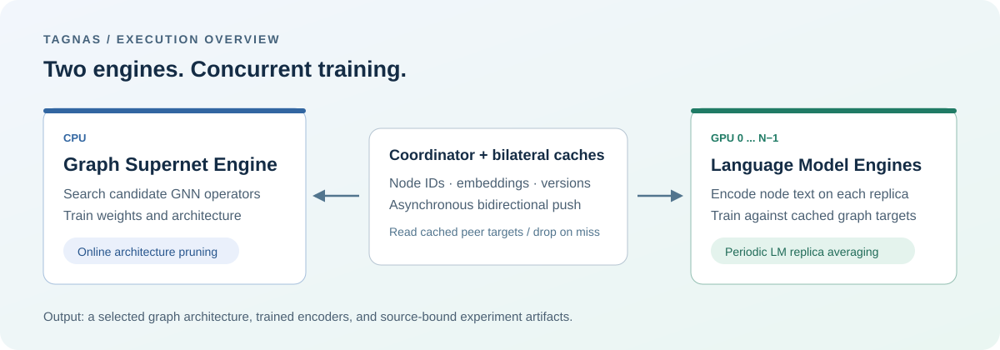

<div align="center">

# TAGNAS

### Scaling Neural Architecture Search on Text-Attributed Graphs

**CPU graph supernet · GPU language models · Asynchronous embedding exchange**

[Run experiments](#run-experiments) · [Data](data/DOWNLOAD.md)



</div>

TAGNAS searches graph neural architectures while training a language model on
node text. The graph supernet runs on the CPU and exchanges embeddings with
GPU language-model workers through bilateral caches.

## Installation

Linux, Python 3.11, [uv](https://docs.astral.sh/uv/), and CUDA-compatible GPUs are required.

```bash
git clone https://github.com/KOJlzx/TAGNAS.git
cd TAGNAS
uv sync --locked
```

The Python package is named `clip_graph`. Prepare the datasets following
[data/DOWNLOAD.md](data/DOWNLOAD.md), then cache the language model:

```bash
uv run python - <<'MODEL'
from transformers import AutoModel, AutoTokenizer
AutoTokenizer.from_pretrained("distilgpt2")
AutoModel.from_pretrained("distilgpt2")
MODEL
```

## Run experiments

Run TAGNAS from the repository root, selecting the GPUs available to you:

```bash
CUDA_VISIBLE_DEVICES=0,1,2 HF_OFFLINE=true \
  DATASET=pubmed PHASE=search NUM_TEXT_WORKERS=3 SEED=42 \
  GRAPH_K_HOP=1 NUM_LAYERS=3 GRAPH_BATCH_SIZE=1024 TEXT_CHUNK_SIZE=60 \
  TRAIN_NODE_FRACTION=1.0 bash run_sys.sh
```

Use `PHASE=search`, `retrain`, or `both` to select the training stage.
For CLI options, run `uv run python bin/async_coexec_train.py --help`.

| System | Runner |
| --- | --- |
| TAGNAS | [`run_sys.sh`](run_sys.sh) |
| ConGraT | [`run_clip.sh`](run_clip.sh) |
| DDP | [`run_ddp.sh`](run_ddp.sh) |
| ZeRO-Offload | [`run_deepspeed.sh`](run_deepspeed.sh) |
| UniTG-style | [`run_unitg.sh`](run_unitg.sh) |

The [experiment scripts](experiments/README.md) cover end-to-end performance,
memory, scaling, time breakdown, ablation, and CPU sensitivity.
Training and evaluation commands are in [`bin/`](bin/README.md);
model and dataset settings are in [`configs/`](configs/README.md).

## License

[MIT](LICENSE). See [third-party notices](THIRD_PARTY_NOTICES.md) and
[citation information](CITATION.cff).
