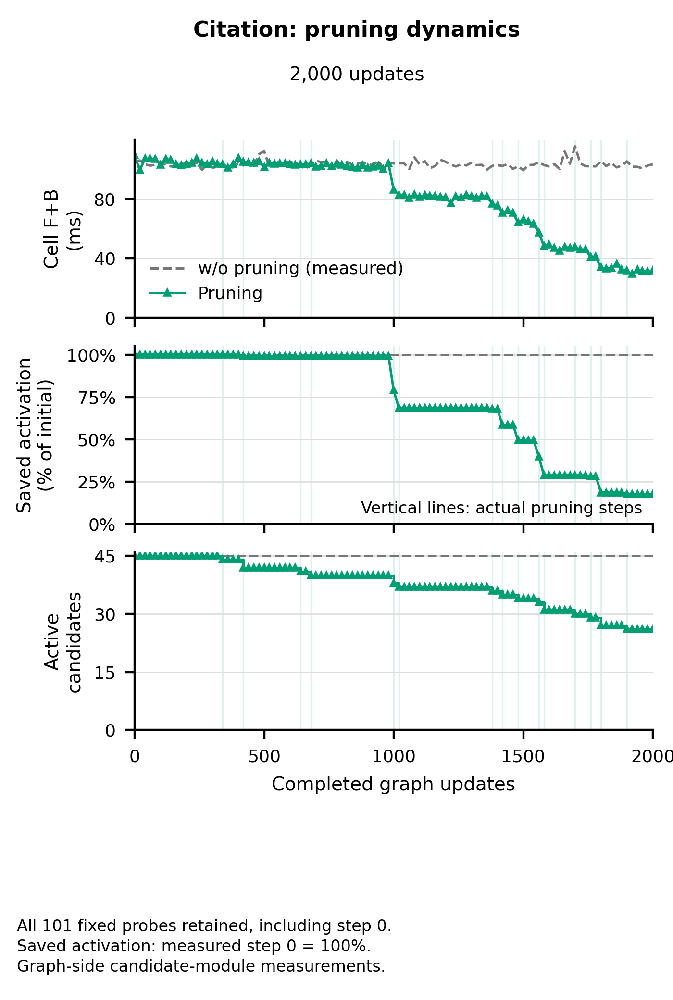

# Pruning dynamics



[PDF](figure.pdf) · [Plot data](plot_data.csv) · [Summary](summary.csv) · [Pruning steps](pruning_steps.csv)

```bash
uv run python artifacts/pruning/draw.py --output-dir /path/to/output
```
